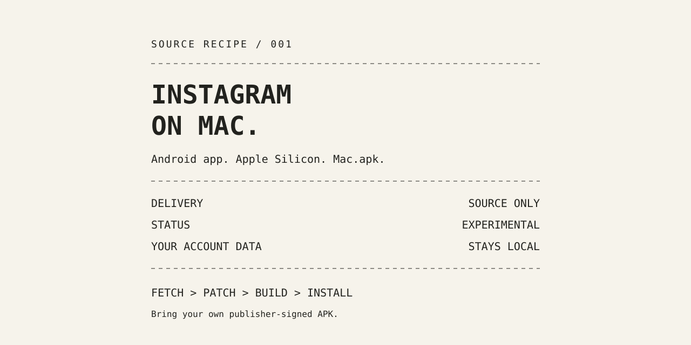

# Instagram on Mac



Build a source-only Mac.apk compatibility runtime for Instagram on Apple Silicon. The recipe downloads the pinned Mac.apk release, applies this repository's tested patches, builds the runtime, and signs it with a local signing identity.

> **Experimental prerelease:** The media gallery and import path are under test. Video preview after **Next** can remain blank and can use high CPU. End-to-end posting is not verified. Camera, video-selfie verification, and other Instagram screens are not guaranteed.

This repository does not include Instagram or Mac.apk application binaries, an Instagram package, account data, signing keys, or a local signing identity. Mac.apk runs Android app code through a native ARM64 compatibility runtime. It is not an Android virtual machine and does not rebuild Instagram's code.

## Supported setup

- Apple Silicon Mac running macOS 26.4 or newer.
- Xcode Command Line Tools, Homebrew, Python 3, and JDK 21.
- CMake, Capstone, libpng, and libvpx for the runtime build.
- An external drive for downloads, build files, and app data.
- Instagram 445.0.0.45.83 only. The patch set is tied to the source and Mac.apk release pins in [upstream.lock.json](upstream.lock.json).
- A local code-signing identity. Set `MACAPK_SIGN_IDENTITY`, or let the build read the signing authority from an existing `/Applications/Mac.apk.app`. Ad-hoc signing is refused. A readable authority name does not prove its private key is available; the build's signing step is the final check.

For a fresh setup, provide a signing certificate and its matching private key through macOS code signing. See [Apple's code-signing guide](https://developer.apple.com/library/archive/documentation/Security/Conceptual/CodeSigningGuide/Procedures/Procedures.html). Set `MACAPK_SIGN_IDENTITY` to the local certificate name before running `doctor` or `install`. The recipe does not create, export, or publish signing keys.

Install the build tools:

```sh
xcode-select --install
brew install cmake openjdk@21 capstone libpng libvpx python
export PATH="$(brew --prefix openjdk@21)/bin:$PATH"
```

Homebrew's OpenJDK 21 formula is keg-only. The `PATH` line makes `java` and `javac` available to the recipe.

## Quick start

Download the trusted Instagram 445.0.0.45.83 package outside this repository. Use a complete XAPK, APKM, or APKS package when the app needs resource splits.

```sh
git clone https://github.com/surajmandalcell/instagramOnMac.git
cd instagramOnMac
export INSTAGRAM_ON_MAC_CACHE="/Volumes/Data/instagram-on-mac-build"
./instagram-on-mac doctor --locked
./instagram-on-mac install --apk "/Volumes/Data/Instagram.xapk" --locked
```

Replace `/Volumes/Data` with your external drive's mount path. Keep the APK outside the repository.

`--locked` uses the tested upstream pin without checking for a newer release. The recipe still checks its download digests, Instagram package signature, and pinned publisher certificates. The build checks that the signing identity can sign. Do not use an APK from an unknown source. Meta does not provide a public, credential-free APK download through this recipe.

`doctor` checks for a configured or existing signing authority name. It cannot confirm that the matching private key is available; only a successful signing step proves that.

## Commands

```sh
./instagram-on-mac doctor [--locked]
./instagram-on-mac fetch [--locked]
./instagram-on-mac build [--dry-run] [--rebuild] [--locked]
./instagram-on-mac install [--apk PATH] [--apk-url URL --apk-sha256 SHA256] [--locked]
./instagram-on-mac update [--check]
```

`update --check` only checks whether the latest Mac.apk release still matches the tested pin. `update` builds and installs the pinned runtime. It stops safely when upstream releases an unreviewed version. `update --locked` is not supported.

`--dry-run` stops before installation. `--rebuild` forces a fresh build. `--cache DIR` and `--appdata-root DIR` choose external storage locations. `--applications DIR` changes the install directory. An `--apk-url` must use HTTPS and requires its matching `--apk-sha256`.

Runtime updates keep the installed Instagram package and its existing data link. The installer does not uninstall Instagram, reset its data, copy credentials, or log accounts out. Replacing an installed APK is blocked until a data migration route is verified. Close Mac.apk and Instagram before installing.

Instagram can expire a session or request a new login. Keeping app data does not prevent those server decisions.

## Data and cache

Build files and downloads stay outside the repository on an external drive. The default cache is under `AGENT_DATA_DIR/instagramOnMac`; if that variable is unset, the recipe uses its external-drive default. Set `INSTAGRAM_ON_MAC_CACHE` or `--cache` to choose another external directory. The cache must stay outside this repository.

For a first install, app data defaults to `instagramOnMac/apps` under the external data root. Mac.apk support files use a sibling `support` directory. Set `MACAPK_APPDATA_ROOT` or `--appdata-root` to choose an external data root. Existing Instagram data links take priority during runtime updates. Ambiguous or system-drive data layouts stop before installation.

The build cache and app data are separate. Removing the build cache does not remove Instagram data.

## Media behavior and limits

The gallery shows files selected with **Browse**. It does not scan Photos or other folders. Selected originals stay in place and are opened read-only. MOV files use a separate cached MP4 for preview and editing; an unchanged source can reuse its cache. Editing writes separate output files.

Video preview after **Next** is not reliable in this prerelease. Do not rely on this build for posting or account verification. Never enter credentials, one-time codes, or identity information into a diagnostic flow.

Mac.apk is not sandboxed from the Mac user's files. Only run APK packages and Mac.apk releases that you trust. See [Mac.apk's security notice](https://github.com/kksimp/Mac.apk#disclaimer).

## Checks

```sh
python3 -B scripts/check_privacy.py
python3 -B scripts/check_privacy.py --staged
python3 -B -m unittest discover -s tests -p '*test*.py'
```

The privacy check rejects app payloads, media, keys, personal paths, local identifiers, and known credential formats. It checks staged content and commit metadata without printing matched values. It reduces mistakes; it cannot prove arbitrary code is safe.

## Source and license

Mac.apk source and release pins are listed in [upstream.lock.json](upstream.lock.json). Publisher certificate pins come from [Instagram's Android asset links](https://www.instagram.com/.well-known/assetlinks.json). Tool downloads and their SHA-256 digests are pinned separately in [tools.lock.json](tools.lock.json).

The patches derive from [Mac.apk](https://github.com/kksimp/Mac.apk). This recipe and its patches use [AGPL-3.0-only](LICENSE). Upstream copyright, license, trademark, and third-party notices remain with the downloaded source and official app assets.

This is an independent project, unaffiliated with Meta, Instagram, or the Mac.apk authors. Instagram and other product names belong to their respective owners. The cover is original vector artwork and contains no app screenshot.

See [CONTRIBUTING.md](CONTRIBUTING.md) to change the recipe and [SECURITY.md](SECURITY.md) to report security issues.
