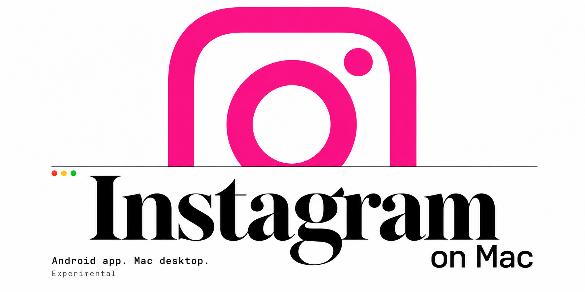

# Instagram on Mac



Instagram APK, running natively on Mac. Built for browsing and posting.

## Instructions for Humans

- Home, Back, options, and volume controls.
- Browse your own images and videos. No Photos scanning; originals stay read-only.
- Convert MOV once and reuse the cached MP4.
- Update the runtime while keeping your app data.

You need Apple Silicon, macOS 26.4+, an external drive, and a local code-signing certificate. Supply a trusted Instagram **445.0.0.45.83** package.

**Install with your coding agent:**

> Install https://github.com/surajmandalcell/instagramOnMac using Instructions for Agents. Keep my app data safe and do not publish test posts.

<details>
<summary>Install from the terminal</summary>

Install Xcode Command Line Tools first. Replace `/Volumes/Data` with your external drive:

```sh
brew install cmake openjdk@21 capstone libpng libvpx python
git clone https://github.com/surajmandalcell/instagramOnMac.git && cd instagramOnMac
export INSTAGRAM_ON_MAC_CACHE="/Volumes/Data/instagram-on-mac-build"
./instagram-on-mac doctor --locked
./instagram-on-mac install --apk "/Volumes/Data/Instagram.xapk" --locked
```

Set `MACAPK_SIGN_IDENTITY` to your certificate name if you have no existing Mac.apk install. Keep the same certificate for updates.

</details>

**Update:** quit Instagram and Mac.apk, then run `./instagram-on-mac update`.

**Known issue:** the video editor can open blank and use high CPU. Posting is not yet verified.

## Instructions for Agents

<details>
<summary>Setup, checks, and safety rules</summary>

This recipe builds [Mac.apk](https://github.com/kksimp/Mac.apk) locally from pinned source and patches. It distributes no app or APK binaries.

1. Read `specs/project.md`, `upstream.lock.json`, `tools.lock.json`, `src/workflow.py`, and `src/apk_tools.py` before changing or installing anything.
2. Use Apple Silicon, macOS 26.4+, Mac.apk 1.0.2303, and Instagram 445.0.0.45.83 only. The lock pins the Mac.apk source commit, release digest, patch digests, Google tools, and Instagram publisher certificates.
3. Keep build output and app data on an external drive. Use `INSTAGRAM_ON_MAC_CACHE` or `--cache` for the build cache; use `MACAPK_APPDATA_ROOT` or `--appdata-root` for app data. Existing data links take priority during runtime updates.
   Install Xcode Command Line Tools and `cmake openjdk@21 capstone libpng libvpx python` with Homebrew. The recipe resolves Homebrew JDK 21 itself. `MACAPK_JDK_HOME` can select another complete JDK 21 home. For signing setup, see [Apple's code-signing guide](https://developer.apple.com/library/archive/documentation/Security/Conceptual/CodeSigningGuide/Procedures/Procedures.html).
4. Run the privacy and unit checks:

   ```sh
   python3 -B scripts/check_privacy.py
   python3 -B -m unittest discover -s tests -p '*test*.py'
   ```

5. Use `./instagram-on-mac doctor --locked` for host and identity-name checks. Only successful code signing proves that the private key is available.
6. Build or install with `--locked` to use the tested pin without a latest-release check. Downloads still require HTTPS and pinned SHA-256 digests; APK installs still require a trusted publisher signature and the exact supported Instagram version.

   ```sh
   ./instagram-on-mac fetch --locked
   ./instagram-on-mac build --locked --dry-run
   ./instagram-on-mac build --locked
   ./instagram-on-mac install --apk PATH --locked
   ./instagram-on-mac install --apk-url URL --apk-sha256 SHA256 --locked
   ./instagram-on-mac update --check
   ./instagram-on-mac update
   ```

`update --locked` is invalid. Updates stop when upstream no longer matches the tested release. Install stops if Mac.apk or Instagram is running, if package checks fail, or if data layout is ambiguous. Runtime updates preserve the installed package and app-data link; APK replacement requires a verified migration. The installer rolls back the app and shared runtime if installation fails.

Never read Keychain, credentials, cookies, tokens, account databases, or saved-account stores. Use synthetic media only. Do not commit APKs, app bundles, caches, logs, screenshots, media, generated outputs, signing keys, or personal paths. The app runtime is not sandboxed from the Mac user's files.

Do not claim the video editor works after **Next**: it can show a blank preview and high CPU, and full posting is unverified. Camera, video-selfie verification, and other Instagram screens are outside the verified scope. Never press Share or publish during checks.

Use `scripts/check_privacy.py` before sharing changes. See `SECURITY.md` for security reports and `CONTRIBUTING.md` for patch and test rules. The source pins live in `upstream.lock.json`; implementation and test coverage lives in `src/`, `patches/`, and `tests/`.

</details>

[License](LICENSE) · [Contributing](CONTRIBUTING.md) · [Security](SECURITY.md)

Unaffiliated with Meta, Instagram, or the Mac.apk authors.
